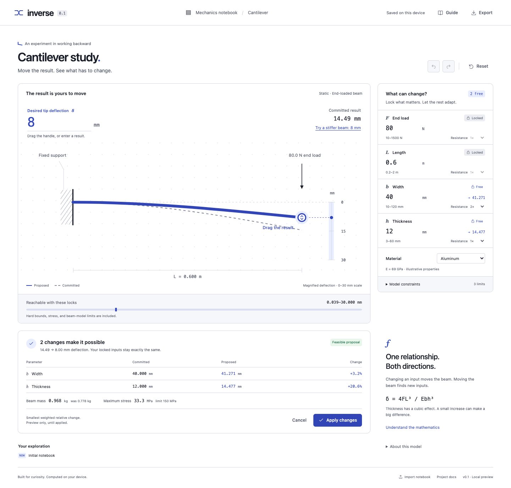

# Inverse — an interactive notebook for inverse problems

**Move the result. See what must change.**

[MIT license](LICENSE) · [Quick start](#try-it-locally) · [Research foundations](docs/RESEARCH.md) · [Contribute](CONTRIBUTING.md) · [Contact Burhan](mailto:burhanmujahid552@gmail.com)

Inverse is an open-source computational notebook for working backward from a desired result. Set a target, lock the inputs that matter, and inspect the smallest permitted changes to the remaining inputs. Every proposal shows its consequences before you apply it.

The working prototype is a **cantilever beam notebook**, backed by a small convex optimization engine in plain JavaScript. The broader idea is an environment where people can explore mathematical relationships from either direction.



*A real screenshot of the prototype: reduce tip deflection from 14.49 mm to 8 mm while keeping the load and length fixed.*

## Why this exists

Many computational tools start with inputs and ask, “What happens?” Design and learning often start with a different question: **“I want this outcome. What would need to change?”**

Inverse makes that question directly interactive. It combines outcome editing, explicit constraints, transparent tradeoffs, and reversible changes in one notebook. The first beam model keeps both the mathematics and the limitations inspectable.

This is an early working prototype seeking contributors, research collaborators, educators, and people with real modeling workflows. Usefulness across other domains is a hypothesis to test; the current implementation supports one model.

## Try it locally

Requires **Node.js 24+** and a modern browser. No API key, account, or dependency installation is needed to run the app.

```sh
git clone https://github.com/burhan-mujahid/inverse-notebook.git
cd inverse-notebook
npm run dev
```

Open **http://127.0.0.1:5173**. If you already have the source folder, start with `npm run dev` there. For a busy port, use `PORT=5174 npm run dev`.

1. Click **Try a stiffer beam: 8 mm**.
2. Inspect the proposed width and thickness changes. Force and length stay locked.
3. Click **Apply changes**, then **Undo** to restore the starting point.
4. Lock width and try again: only thickness can change.
5. Request an unreachable target and inspect the reachable interval and constraints.

The default example proposes approximately **41.271 mm width** and **14.477 mm thickness**, starting from 40 mm and 12 mm. These values follow the selected change weights; different preferences produce different proposals.

## What works today

| Capability | Current behavior |
| --- | --- |
| Direct manipulation | Drag the beam endpoint, use the keyboard, or enter a target number |
| Constrained inverse solving | Exact locks, hard parameter bounds, and weighted relative changes |
| Feasibility feedback | Reachable output interval and explicit invalid, unreachable, or numerical-failure states |
| Explainable proposals | Before/after values, mass, stress, equations, and binding constraints |
| Reversible exploration | Preview, Apply, Cancel, Undo/Redo, and reset |
| Local data | Device-local save and validated JSON import/export |
| Small runtime | Native browser modules and SVG; no third-party runtime dependencies or cloud/model calls |

## The mathematical basis

For a rectangular cantilever with an end load:

$$\delta = \frac{4FL^3}{Ebh^3}$$

Here $F$ is force, $L$ length, $E$ Young's modulus, $b$ width, and $h$ thickness. The selected material stays fixed during each inverse request.

Positive power-law relationships become linear in logarithmic coordinates. With $z_i = \ln(x_i/x_{0,i})$, Inverse minimizes:

$$\frac{1}{2}\sum_i w_i z_i^2$$

subject to the desired result, locks, bounds, and the model's log-linear constraints. “Smallest change” means this specific weighted relative-change metric. For a feasible target and positive weights, the supported formulation has a unique minimum in the free coordinates, subject to floating-point tolerances in its implementation.

Read the [complete equations and solver contract](docs/02-mathematics.md) or the [research foundations and open questions](docs/RESEARCH.md). The implementation connects established ideas from constraint-based interfaces, explorable explanations, and convex optimization; it does not claim to invent those fields.

## Who I want to connect with

I'm **Burhan Mujahid**, the project maintainer. I want to find people who can help turn this prototype into something useful in real workflows.

| Your background | A useful starting point |
| --- | --- |
| HCI / interaction research | Evaluate whether editing outcomes helps people reason about constraints and tradeoffs |
| Optimization / numerical methods | Review the solver contract, conditioning, or independent verification cases |
| Programming tools / scientific computing | Explore reusable model declarations after a second model proves the need |
| Engineering or STEM education | Try a teaching exercise and report where the explanation helps or confuses |
| Product design / accessibility | Review touch, keyboard, and screen-reader interactions |
| Potential early user or partner | Bring a concrete workflow, target outcome, and constraints for a small pilot |

**Contact: [burhanmujahid552@gmail.com](mailto:burhanmujahid552@gmail.com)** · [GitHub: @burhan-mujahid](https://github.com/burhan-mujahid)

For an introduction, tell me what you work on, which result you wish you could manipulate directly, and what must stay fixed. For public technical proposals, use [Issues](https://github.com/burhan-mujahid/inverse-notebook/issues) or [Discussions](https://github.com/burhan-mujahid/inverse-notebook/discussions). See [contribution paths and starter tasks](CONTRIBUTING.md).

## Research and roadmap

The next milestone is a second small model, such as a spring or simple circuit, with independent analytic tests. After that: model declarations, multiple targets, and meaningful alternative solutions. Approximate nonlinear solvers and discrete choices require separate, explicit guarantees.

The [research brief](docs/RESEARCH.md) includes primary sources, testable questions, and a proposed evaluation. The [roadmap](docs/07-roadmap.md) separates these ambitions from implemented behavior. If you use Inverse in research or teaching, [CITATION.cff](CITATION.cff) provides software citation metadata; include your commit hash for reproducibility.

## Development and verification

```sh
npm test          # mathematical, notebook-state, and publisher checks
npm run check    # JavaScript syntax and local Markdown links
```

Optional browser checks require development dependencies and installed Google Chrome:

```sh
npm ci
# Keep npm run dev running in another terminal.
npm run test:browser
```

The latest local check passes **18 automated tests**. The earlier interface verification passed **47 browser assertions**. See [verification evidence and limitations](docs/STATUS.md) for dates and environments. The GitHub workflow runs the automated tests and source/documentation checks; browser verification is a separate local command.

| Read next | Purpose |
| --- | --- |
| [Product](PRODUCT.md) | Audience, scope, and first-release contract |
| [Project guide](docs/00-guide.md) | Full documentation map |
| [Architecture](docs/03-architecture.md) | Modules and data flow |
| [Development](docs/05-development.md) | Run, debug, and extend the notebook |
| [Verification](docs/06-verification.md) | Analytic oracles and interaction checks |
| [Decisions](docs/08-decisions.md) | Design choices and tradeoffs |

## Scope and limitations

This is an **educational computational model**, not an engineering sign-off tool. Material values are illustrative. The beam model omits effects including shear deformation, buckling, plasticity, self-weight, and dynamics. Its screening constraints are project choices, not engineering standards.

The solver supports a narrow positive-monomial/log-linear model class and at most four variables. It does not invert arbitrary programs or equations. There is no general authoring UI, multi-output solver, or completed user study. See the [model assumptions](docs/02-mathematics.md) before interpreting results.

## License

[MIT](LICENSE) · Copyright (c) 2026 Burhan Mujahid. Third-party development dependencies retain their own licenses.
