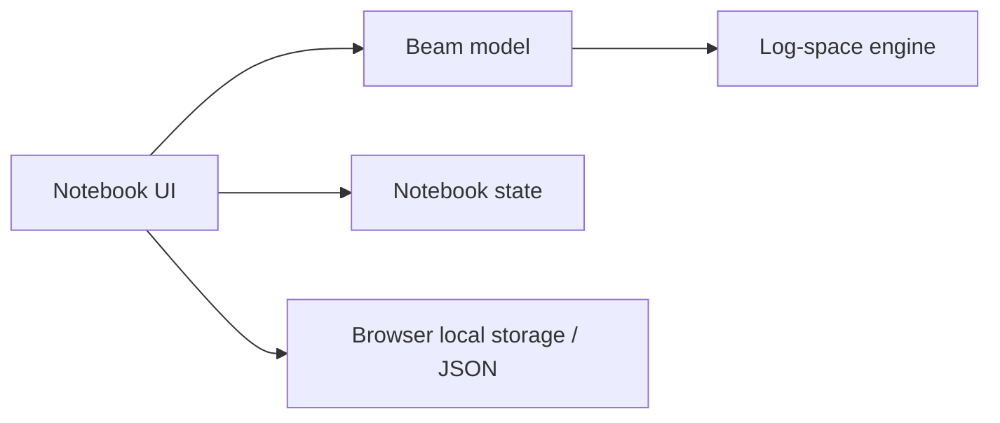

# Architecture

## Stack

Native browser JavaScript modules, HTML, CSS, SVG, and a small Node development server. Use Node's built-in test runner. No runtime package dependencies, backend database, model provider, or bundler is needed for the initial size of the application. JavaScript is documented with JSDoc where useful; mathematical contracts and runtime validation remain explicit.

## Source layout

```text
index.html                  application entry and metadata
src/main.js                 DOM, input events, preview/apply lifecycle
src/styles.css              interface tokens, layout, responsive behavior
src/engine.js               pure low-dimensional log-space solver
src/beam.js                 physical model, bounds, constraints, display metadata
src/notebook.js             state validation, serialization, undo/redo
scripts/dev.mjs             local static server, loopback only
scripts/check.mjs           source and document checks
scripts/browser-check.mjs   optional browser acceptance automation
public/favicon.svg          small project mark
test/engine.test.js         independent mathematical checks
test/notebook.test.js       state/import/history checks
```


## Dependency direction



The numerical engine has no browser, storage, or physical-model dependencies. The beam adapter supplies exponents, baseline quantities, and constraints. The notebook state layer validates external data and owns complete-state history. The UI formats SI quantities and renders computed results.

## Solver boundary

Input: finite positive baseline vector, finite exponents, positive weights, per-coordinate locks and bounds, log-linear inequalities, and an optional positive target ratio.

Output: explicit status, feasible log-output interval, proposed coordinates when feasible, objective value, and binding constraint names. Do not use undefined or NaN as a status signal.

The engine supports at most four variables in v0.1. Its internal enumeration cap is enforced rather than left as an undocumented performance trap.

## State model

A versioned saved notebook includes its model identifier, selected material, SI parameter object, lock object, and weight object. Desired output is ephemeral preview state and does not overwrite committed inputs. A complete committed snapshot is the unit of Undo and Redo.

Import reconstructs the allowlisted state fields, validates numeric values and enum members, and rejects unsupported model/schema versions. Never evaluate imported strings as code or insert imported content as HTML.

## Preview transaction

1. Read committed snapshot.
2. Map desired output into an inverse request.
3. Solve from that same snapshot.
4. Forward-evaluate and verify the candidate.
5. Render proposal and differences.
6. Apply only when the request is feasible and makes a meaningful change.
7. Commit one history entry, then save the committed state.

Changing locks/weights/inputs is a separate committed transaction and cancels a stale proposal. Undo also cancels previews. The DOM for input controls and the drag handle is stable across rendering to preserve focus and pointer capture.

## Local persistence

Use one versioned localStorage key. Catch both read and write exceptions. No network request is required after the local application assets load. JSON export is the portable fallback. History is in memory with a fixed limit.

## Performance

Recompute previews at most once per animation frame during pointer movement. Cache the feasible region while the committed state remains unchanged. Use the same small solver in Node tests and the browser. Record timings as measurements on the actual machine, never as universal guarantees.

## Serving and security

The dev server binds 127.0.0.1, serves a small allowlist of project assets/docs, checks URL paths, and uses explicit MIME types. There are no write endpoints. User imports are parsed as JSON and validated. Documentation links are static. No remote scripts, analytics, fonts, or tokens are needed.

## Current API and result shapes

`prepare(spec)` creates a baseline-specific region. `spec` contains `values`, `exponents`, `bounds` (`min`, `max`, optional `label`), `locked`, `weights`, and optional inequality rows `{a, b, label}` in log coordinates. It validates dimensions and domains, then returns `status: ready | empty`, `free`, `constraints`, `vertices`, and a log-output `range`.

`solve(region, logTarget)` returns `status: solved | unreachable | empty | invalid | numerical-failure`. A solved result includes full-coordinate `values`, `objective`, `active` constraint labels, and the range. Locked coordinates are copied directly.

`prepareBeam(state)` adapts the physical notebook and converts the feasible interval into meters. `inverseBeam(prepared, targetMeters)` performs the solve, reconstructs named parameters, and forward-verifies the candidate.

`History` stores `current`, `past`, and `future`, with `commit`, `undo`, and `redo`. Its snapshots are validated and history is bounded to 40 changes. Browser local storage and downloads are handled only by the UI.
